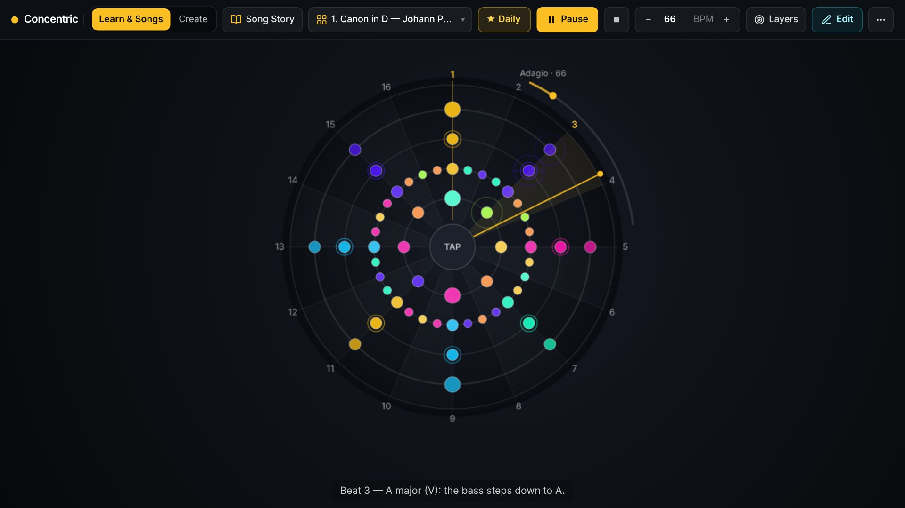
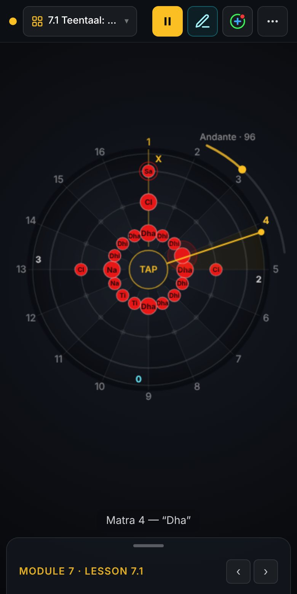

# Concentric · Music on wheels

**See music, hear it, and make your own: rhythm, harmony and melody drawn as rings on a wheel.**

▶ **Try it:** [sunboo.github.io/musiconwheels](https://sunboo.github.io/musiconwheels/). Free, no sign-up, works on any phone or laptop, and offline after the first visit.

<p align="center">
  
  &nbsp;
  
</p>

---

## What it is

Concentric turns a piece of music into a wheel you can watch while it plays.

- **Around the wheel is time.** One trip round is one loop; the numbers on the rim are the beats.
- **Each ring is a part.** Bass on the outside, chords in the middle, melody inside, drums on their own ring.
- **Each dot is a note.** Its colour is the pitch, its brightness the octave, its size how loud it is. A halo means a chord.

Because the pattern stays still while a needle sweeps round, you can *see* things that are hard to hear at first: why a waltz feels like a waltz, why a clave pulls, why one changed note makes a chord sad. Then you can change it yourself and hear the difference straight away.

It's built for curious beginners, school students, teachers and anyone who wants to understand the music they love, in a few minutes a day.

## What you can do

**Learn**
- **36 short lessons in 8 modules:** pulse and metre, pitch and colour, chords, progressions and cadences, song structure, polyrhythm, Indian taal and raga, and blues and swing.
- Each lesson plays at once, explains "why it works" in plain words, and often has two versions to compare, such as a straight and a swung beat.
- Tools that help it stick:
  - **Ear check:** can you tell which version is playing?
  - **Show the notes:** the melody written on a staff.
  - **Badges and progress:** ticks for finished lessons and a few small awards.

**Play songs**
- **About 40 pieces, almost all in the public domain:**
  - **Nursery rhymes:** Twinkle Twinkle, Frère Jacques, Happy Birthday and more.
  - **Holiday songs:** Jingle Bells, Silent Night, Auld Lang Syne and more.
  - **Folk tunes:** Sakura, Amazing Grace, Korobeiniki and more.
  - **Classical moments:** Pachelbel's Canon, Für Elise, Beethoven's 5th, Mountain King, Holst's Mars, Zarathustra and more.
- **Anthem openings** (USA, UK), which are play-only.
- **★ Daily puzzle:** name today's mystery tune in three tries, keep a streak, and share your score.

**Create**
- Start from a template (pop, electronic, waltz, polyrhythm or blank) and paint notes and chords onto the rings.
- Press **✦ Random Groove** for an instant idea, then make it yours.
- **Remix** anything: add swing, speed up every loop, build up one ring at a time, or flip major ↔ minor.

**Share and teach**
- **Share a link** that carries your version inside it. Nothing is uploaded.
- **Save a video** (9:16, for Reels and Shorts) or a **poster** with the name of your piece and your name as composer.
- **Embed** the player on a blog or course page.
- **Projector view** for classrooms.
- **Assignment links** that show your task above the wheel.

**For everyone**
- Works with the keyboard and screen readers.
- Note letters on the dots for colour-blind users.
- A visual beat flash for Deaf and hard-of-hearing users.
- A Lite mode for older phones.
- Headphone sync for Bluetooth delay.
- Sa Re Ga note names in the Indian music lessons.

## Privacy and rights

- **No accounts, no cookies, no ads.** Your edits and progress stay in your own browser. Optional visit counts are anonymous and cookie-free. See the [privacy page](https://sunboo.github.io/musiconwheels/privacy.html).
- **Music rights:**
  - Songs are either in the public domain (arranged by us, melodies only, never lyrics) or very short educational arrangements.
  - Two songs whose riffs are still under copyright can be played but not shared or exported.
  - National anthems are openings only, play-only, and only where the law allows.
  - See the [terms and takedown page](https://sunboo.github.io/musiconwheels/terms.html).

## What's next

Released versions and the plan (more public-domain songs, more anthems, deeper learning tools) are in **[ROADMAP.md](ROADMAP.md)**. Each release is described in [CHANGES.md](CHANGES.md).

Ideas, bugs or a song you'd like to see? Open an issue in this repository.

## Licence

- **Code:** [MIT](LICENSE).
- **Lesson text and arrangements:** [CC BY-NC 4.0](CONTENT-LICENSE.md). Free to share and adapt for non-commercial use, with credit.
- **Credits and third-party notices:** [NOTICE.txt](NOTICE.txt).

Concentric is not affiliated with any artist, label, publisher, studio, school or government. Names are used only to identify the music being studied.

---

<details>
<summary><strong>For developers: how it's built, how to run it, how to change it</strong></summary>

### How it's built

Plain HTML, CSS and JavaScript modules. No framework, no build step to run it, and no external CDNs.

- **Sound:** synthesised in the browser with the Web Audio API. Short sounds are rendered once and reused.
- **Timing:** a look-ahead scheduler runs on the audio clock, so notes land exactly on the grid even on slow phones.
- **Drawing:** two stacked canvases. The still parts are drawn once, and nothing is redrawn while paused.
- **Size:** the whole app is about 105 KB compressed, under a 200 KB budget that is checked automatically.

### Run it locally

ES modules don't load from `file://`, so serve the folder:

```bash
python3 -m http.server 8765
# open http://localhost:8765
```

### Publish (GitHub Pages)

1. In **Settings → Pages**, choose **Deploy from a branch**, branch **main**, folder **/ (root)**.
2. After every change, raise `VERSION` in `sw.js` (e.g. `v3.1.0` → `v3.1.1`) so returning visitors get the update.
3. If lessons change, re-run `node tools/seo.mjs https://sunboo.github.io/musiconwheels` to refresh the search pages and `sitemap.xml`.

The `.nojekyll` file tells GitHub to serve the files as they are.

### Project layout

```
index.html              page markup
css/app.css             compiled stylesheet
sw.js                   offline support (bump VERSION on every release)
manifest.webmanifest    install as an app
js/main.js              app wiring and state
js/audio.js             audio engine: synth voices, drums, tabla, reverb, limiter
js/scheduler.js         look-ahead scheduler on the audio clock (+ swing)
js/clock-worker.js      background-safe timer for the scheduler
js/render.js            the wheel (still layer + moving layer)
js/theory.js            notes, colours, chords, voice leading, note lengths
js/content.js           lessons 1.1–6.2, original songs, Create templates
js/lessons-extra.js     lessons 1.7, 2.5, 2.6, 4.4, 5.4 and Modules 7–8
js/songs.js             public-domain songs and anthems in a compact text format
js/content-helpers.js   shared helper for the data files
js/library.js           Library: search, filters, favourites, recents
js/progress.js          progress, badges, daily puzzle (this browser only)
js/share.js             share links (#w=…)
js/export.js            poster and 9:16 video
js/notation.js          "Show the notes" staff view
js/groove.js            Random Groove
js/analytics.js         optional, cookie-free usage counts
js/config.js            site settings (GoatCounter code)
js/lint.js              data checks (debug only)
learn/                  generated search pages, one per lesson and song
tools/                  tests, benchmark, search-page generator, stylesheet build
docs/                   screenshots for this README
```

### Adding a public-domain song

Add an entry to `SONGS` in `js/songs.js`.

- **Melody:** notes are written `name+octave:length`, e.g. `E4:2 D4:2 C4:4`. Length is in steps; `r` is a rest.
- **Chords:** written `symbol:beats`, e.g. `C:4 G7:2`. Allowed symbols are `C`, `Am`, `G7`, `Cmaj7`, `Csus4`, `Bdim`, and `N` for no chord.
- **Rule:** the chords must cover exactly as many beats as the melody, or the song won't load.

Then run the tests: they flag melody notes that clash with the chord.

### Tests, benchmark and styles

```bash
npm i -D playwright && npx playwright install chromium
python3 -m http.server 8765 &
node tools/test.mjs      # behaviour checks
node tools/bench.mjs     # timing, redraws, audio nodes, CPU at 1× and 6×, download size
```

`.github/workflows/checks.yml` runs both on every push; results are under the **Actions** tab.

The stylesheet is pre-compiled. If you add or change Tailwind classes, rebuild it:

```bash
cd tools/css-build && npm install && npx tailwindcss -c tailwind.config.js -i src.css -o ../../css/app.css --minify
```

### Useful URL options

| URL | What it does |
|---|---|
| `?item=song-canon` | Open a lesson, song or template (ids are in the `js/` data files). |
| `?item=7.4&scene=1` | Open a lesson on a given Compare version (counting from 0). |
| `?embed=1` | Compact player for iframes. |
| `?present=1` | Projector view. |
| `?a=<task>` | Show a teacher's task (assignment links). |
| `?daily=1` | Open today's daily puzzle. |
| `?opener=1` | Show the first-visit "name this tune" opener again. |
| `?quality=lite` / `full` | Force Lite or Full quality. |
| `?debug=1` | Run the data checks (see the console). |
| `#w=…` | A shared version, packed into the link. |

### Usage counts (optional)

Anonymous, cookie-free counts with [GoatCounter](https://www.goatcounter.com). Put your site code in `js/config.js`:

```js
goatcounter: 'your-code'
```

Leave it empty to send nothing. Nothing is sent from localhost or when the browser's Do Not Track is on. Events appear in GoatCounter as `event/…`:

| Area | Events |
|---|---|
| Visits | `first-visit`, `return-d1`, `return-d7`, `return-d30` |
| Listening and learning | `play`, `lesson-complete`, `notes`, `ear-right`, `ear-wrong` |
| Create | `create-open`, `create-first-edit`, `random-groove`, `edit` |
| Video, poster, audio | `video`, `poster`, `audio-record-start`, `audio-record-saved`, `export` |
| Sharing | `share-open`, `share-link-copied`, `share-link-sent`, `share-embed-copied`, `share-projector-copied`, `share-assignment-copied`, `share-open-link` |
| Daily puzzle | `daily-open`, `daily-solved`, `daily-failed`, `daily-result-copied` |

</details>
